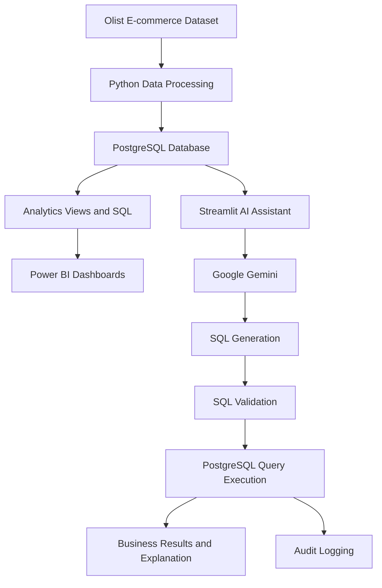

# TrustLens — AI-Powered E-commerce Analytics

<p align="center">
  <strong>A Governed AI Analytics Assistant for E-commerce Delivery and Customer Satisfaction</strong>
</p>

<p align="center">
  
</p>

## Overview

TrustLens is an end-to-end e-commerce analytics project that combines Python, PostgreSQL, Power BI and Generative AI to analyze delivery performance, customer satisfaction and business operations.

It includes interactive Power BI dashboards and an AI-powered Streamlit assistant that converts natural-language business questions into SQL queries, validates them and retrieves results from PostgreSQL.

## Project Screenshots

### 1. Operations Overview


### 2. Delivery Analysis


### 3. TrustLens AI Assistant


### 4. SQL Generation and Database Results


## Business Problem

Late deliveries can negatively affect customer satisfaction and operational performance.

TrustLens helps investigate questions such as:

- Which states have the highest late-delivery rates?
- How do delivery delays relate to customer review scores?
- Which product categories experience more delivery delays?
- Which sellers contribute most to late deliveries?
- How are monthly sales and order trends changing?

## Key Features

- Python-based data ingestion and processing.
- Data quality checks and validation.
- PostgreSQL analytics views and business SQL queries.
- Power BI dashboards for operational monitoring.
- Gemini-powered natural-language SQL generation.
- SQL validation before database execution.
- Database result explanations.
- Audit logging of assistant interactions.

## System Architecture



## Technology Stack

| Area | Technologies |
|---|---|
| Programming | Python |
| Database | PostgreSQL |
| Data Analysis | Pandas, NumPy |
| Visualization | Power BI, Matplotlib |
| Generative AI | Google Gemini |
| SQL Validation | SQLGlot |
| Application | Streamlit |
| Database Connectivity | Psycopg2 |

## Analytics Modules

**Operations Overview**
- Total sales (GMV)
- Total orders
- Average order value
- Average review score
- Late delivery rate
- State-wise delivery performance

**Delivery Analysis**
- Delivery delay buckets
- Review scores by delay bucket
- Actual versus estimated delivery days
- Category-wise late delivery
- State-wise delivery performance

**AI Analytics Assistant**
- Natural-language business questions
- SQL query generation
- SQL validation
- Database result retrieval
- Business-oriented explanations

## AI Assistant Workflow

1. User submits a natural-language question.
2. Gemini generates an SQL query using database schema context.
3. SQLGlot validates the generated query.
4. PostgreSQL executes the approved query.
5. The assistant explains the returned results.
6. The interaction is recorded in the audit log.

## Dataset

**Source:** Brazilian E-Commerce Public Dataset by Olist.

The dataset contains approximately 100,000 orders and multiple related tables covering customers, orders, products, sellers, payments, reviews and geolocation.

## Project Structure

```text
TrustLens/
├── app/
│   └── streamlit_app.py
├── data/
│   ├── raw/
│   └── processed/
├── docs/
│   ├── business_brief.md
│   ├── data_dictionary.md
│   └── data_quality_report.md
├── notebook/
│   └── TrustLens_Python_EDA_Local.ipynb
├── powerbi/
├── screenshots/
├── sql/
├── src/
│   ├── assistant/
│   ├── ingestion/
│   └── validation/
├── tests/
├── .gitignore
├── README.md
└── requirements.txt
```

## Installation and Setup

### 1. Clone the repository

```bash
git clone https://github.com/tabishahmad17/TrustLens.git
cd TrustLens
```

### 2. Create a virtual environment

```bash
python -m venv .venv
```

Activate it on Windows:

```powershell
.venv\\Scripts\\activate
```

### 3. Install dependencies

```bash
pip install -r requirements.txt
```

### 4. Configure environment variables

Create a local `.env` file with the database and Gemini credentials required by your application.

Never commit `.env` or expose API keys and database passwords.

### 5. Configure PostgreSQL

Create the `trustlens` database, load the source dataset, and execute the required SQL scripts to prepare the raw tables, analytics views and application permissions.

### 6. Run the application

```bash
streamlit run app/streamlit_app.py
```

## Security and Governance

- SQL validation before query execution.
- Read-only query execution settings.
- Database connection separation for application operations.
- Audit logging of assistant interactions.
- Environment variables for sensitive configuration.

## Project Limitations

- Analysis is based on historical e-commerce data.
- Observed relationships do not establish causation.
- The assistant depends on the availability of the Gemini API and PostgreSQL database.
- Generated SQL and explanations require appropriate validation and monitoring.

## Project Objective

TrustLens demonstrates how data engineering, SQL analytics, business intelligence and generative AI can work together to support data-driven operational decisions.

---

**Project:** TrustLens  
**Domain:** E-commerce Analytics  
**Focus:** Python | PostgreSQL | Power BI | Generative AI | Business Intelligence

**GitHub:** [tabishahmad17/TrustLens](https://github.com/tabishahmad17/TrustLens)
