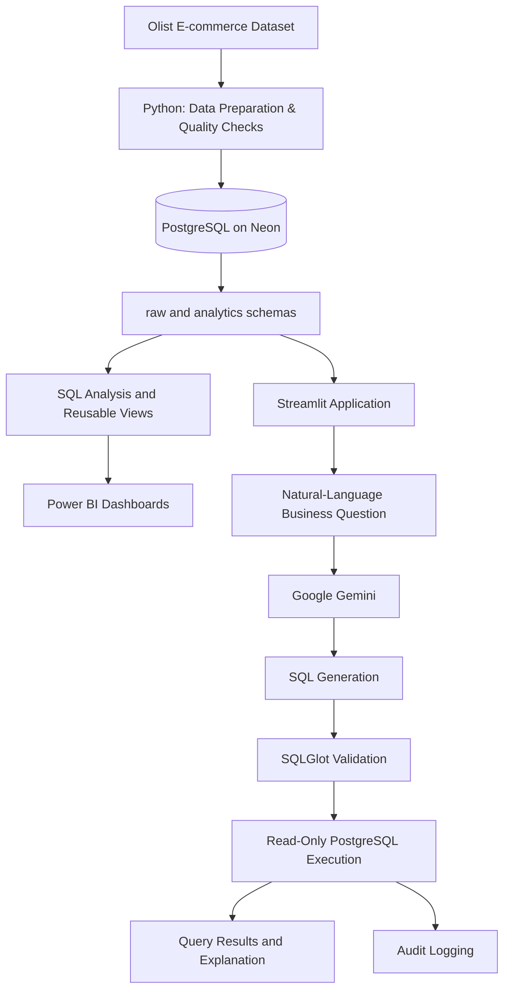

# TrustLens — E-commerce Analytics & Governed AI Assistant

<p align="center">
  <strong>Turn e-commerce data into operational insights with Python, PostgreSQL, Power BI and a Gemini-powered SQL assistant.</strong>
</p>

<p align="center">
  <a href="https://trustlens-u7stusobuiarm6jzslqsyu.streamlit.app/"><strong>🚀 Live Demo</strong></a>
  &nbsp;·&nbsp;
  <a href="https://github.com/tabishahmad17/TrustLens"><strong>Source Code</strong></a>
</p>

<p align="center">
  
</p>

<p align="center">
  
  
  
  
  
</p>

---

## Contents

- [Overview](#overview)
- [Live Demo](#live-demo)
- [Key Features](#key-features)
- [Screenshots](#screenshots)
- [Architecture](#architecture)
- [Technology Stack](#technology-stack)
- [Dataset](#dataset)
- [Key Business Metrics](#key-business-metrics)
- [Data Quality Findings](#data-quality-findings)
- [Repository Structure](#repository-structure)
- [Run Locally](#run-locally)
- [Deployment](#deployment)
- [Database Security and Governance](#database-security-and-governance)
- [Tests and Verification](#tests-and-verification)
- [Limitations](#limitations)
- [Future Improvements](#future-improvements)
- [Dataset Source](#dataset-source)

## Overview

**TrustLens** is an end-to-end e-commerce analytics project built using the [Brazilian E-Commerce Public Dataset by Olist](https://www.kaggle.com/datasets/olistbr/brazilian-ecommerce).

The project brings together Python-based data preparation, PostgreSQL analytics, Power BI reporting and a Streamlit application with a natural-language AI assistant. It explores business questions around order performance, gross merchandise value (GMV), delivery delays and customer reviews.

The application includes two analytical dashboard areas — **Operations Overview** and **Delivery Analysis** — alongside an AI Assistant that helps users ask business questions in natural language and inspect database-backed SQL results.

> **Scope:** TrustLens analyzes historical data and observed patterns. It does not predict or prevent delivery delays, and observed relationships should not be interpreted as proof of causation.

## Live Demo

<p align="center">
  <a href="https://trustlens-u7stusobuiarm6jzslqsyu.streamlit.app/">
    
  </a>
</p>

**Application:** https://trustlens-u7stusobuiarm6jzslqsyu.streamlit.app/

The deployed application connects to a hosted PostgreSQL database on Neon. AI responses also depend on the configured Gemini API key, API availability and quota. A free hosting instance may take a short time to wake up after inactivity.

## Key Features

### 1. Operations Overview
- Monitor total orders, GMV, late-delivery rate and average review score.
- Explore monthly revenue and order trends.
- Review monthly delivery performance.
- Compare operational metrics across states.

### 2. Delivery Analysis
- Filter analysis by purchase-date range.
- Review late-delivery rate and average actual versus estimated delivery days.
- Compare review scores across delivery-delay groups.
- Explore product categories and states by delivery performance.
- Track monthly actual-versus-estimated delivery time.

### 3. TrustLens AI Assistant
- Ask business questions using natural language.
- Use Google Gemini to generate SQL from the available database schema context.
- Validate generated SQL with SQLGlot before execution.
- Inspect the generated SQL and query results.
- Receive a business-oriented explanation of the returned results.
- Record assistant activity in a PostgreSQL audit table.

### 4. Data Preparation and Analytics
- Prepare and inspect source data with Python, Pandas and NumPy.
- Organize source tables and analytical views in separate PostgreSQL schemas.
- Use SQL scripts for data-quality checks and business analysis.
- Connect analytical data to Power BI dashboards and the Streamlit application.

## Screenshots

### Operations Overview


### Delivery Analysis


### AI Assistant


## Architecture



**How it works:** Python is used for data preparation and quality checks. PostgreSQL stores the source and analytical data. SQL views support reporting. Power BI presents business dashboards, while the Streamlit assistant uses Gemini to translate natural-language questions into SQL that is validated before database execution.

## Technology Stack

| Area | Technologies |
|---|---|
| Programming | Python |
| Data preparation | Pandas, NumPy |
| Database | PostgreSQL, Neon |
| Business intelligence | Power BI, DAX |
| Web application | Streamlit |
| Generative AI | Google Gemini (`gemini-2.5-flash`) |
| SQL validation | SQLGlot |
| Database connectivity | Psycopg2 |
| Configuration | python-dotenv |
| Exploration and visualization | Jupyter Notebook, Matplotlib |

## Dataset

TrustLens uses the **Brazilian E-Commerce Public Dataset by Olist**, which contains approximately 100,000 orders and related information about customers, locations, items, payments, reviews, products, sellers and product categories.

The raw schema contains nine source tables:

| Table | Description |
|---|---|
| `customers` | Customer and customer-location identifiers |
| `geolocation` | Brazilian ZIP-code geolocation data |
| `order_items` | Products, sellers, prices and freight per order |
| `order_payments` | Payment methods and payment values |
| `order_reviews` | Customer review scores and comments |
| `orders` | Order status and key order timestamps |
| `products` | Product attributes and category identifiers |
| `sellers` | Seller identifiers and location information |
| `category_translation` | Product-category name translations |

The analytics schema contains reusable views used by reporting and analysis, including `v_monthly_kpis`, `v_order_facts` and `v_seller_performance`.

## Key Business Metrics

The following definitions describe the measures used in the project. Comparisons between PostgreSQL, Power BI and Streamlit should use consistent filters and denominators.

| KPI | Definition |
|---|---|
| **GMV** | Sum of order-item prices. Freight is not included in this item-price definition. |
| **Total Orders** | Count of distinct order IDs in the selected scope. |
| **Average Order Value (AOV)** | GMV divided by total orders, using the same order population and filters. |
| **Late Delivery Rate** | Late delivered orders divided by delivered orders with a known late/on-time classification, expressed as a percentage. |
| **Average Review Score** | Average of available review scores in the selected population. |

A delivery is classified as late when its actual delivery date is later than its estimated delivery date. Delivered orders with a missing actual delivery date are excluded from the eligible denominator because their delivery timing cannot be classified from the available dates.

**Dashboard reference:** The Operations Overview displays GMV of approximately **₹13.5M (₹1.35 crore)**. This is a rounded display value; use the underlying database measure for precise reporting.

## Data Quality Findings

The data-quality checks documented in this repository identified:

- **8 delivered orders** with missing actual delivery dates. These are excluded from the eligible denominator for late-delivery rates.
- **1 delivered order** with no matching payment record.
- **9 source tables** loaded into the raw schema, with row counts documented in [the data-quality report](docs/data_quality_report.md).

These findings describe issues in the source data. They do not establish that any particular operational factor caused late deliveries or lower review scores.

## Repository Structure

```text
TrustLens/
├── app/
│   ├── streamlit_app.py
│   └── dashboard.py
├── data/
│   ├── raw/                  # Source data (not committed)
│   └── processed/            # Processed files (not committed)
├── docs/
│   ├── business_brief.md
│   ├── data_dictionary.md
│   └── data_quality_report.md
├── notebook/
│   └── TrustLens_Python_EDA_Local.ipynb
├── powerbi/                  # Power BI project files
├── screenshots/              # README screenshots
├── sql/
│   ├── 01_data_quality.sql
│   ├── 02_delivery_analysis.sql
│   ├── 03_customer_satisfaction.sql
│   ├── 04_business_analysis.sql
│   ├── 05_read_only_user.sql
│   └── 06_audit_user.sql
├── src/
│   └── assistant/             # AI, database, validation and audit modules
├── tests/
├── .gitignore
├── README.md
└── requirements.txt
```

## Run Locally

### Prerequisites
- Python 3.10 or later.
- PostgreSQL database configured with the TrustLens raw tables, analytics views and audit table.
- Google Gemini API key.
- Git.

### 1. Clone the repository

```bash
git clone https://github.com/tabishahmad17/TrustLens.git
cd TrustLens
```

### 2. Create a virtual environment

**Windows PowerShell**
```powershell
python -m venv .venv
.venv\Scripts\Activate.ps1
```

**macOS / Linux**
```bash
python -m venv .venv
source .venv/bin/activate
```

### 3. Install dependencies

```bash
pip install -r requirements.txt
```

### 4. Configure environment variables

Create a `.env` file in the repository root and add your own credentials:

```dotenv
GEMINI_API_KEY=your_gemini_api_key

DB_HOST=your_postgres_host
DB_PORT=5432
DB_NAME=your_database_name
DB_SSLMODE=require

DB_READER_USER=trustlens_reader
DB_READER_PASSWORD=your_reader_password

DB_AUDIT_USER=trustlens_auditor
DB_AUDIT_PASSWORD=your_auditor_password

# Optional: administrator credentials for database setup tasks
DB_USER=your_admin_username
DB_PASSWORD=your_admin_password
```

The application reads configuration from environment variables, a local `.env` file or Streamlit secrets when deployed. Use separate, least-privilege credentials for the reader and auditor roles. Do not use the database-owner account for routine analytics queries.

> **Security:** Never commit your `.env` file, API keys or database passwords. Use your own credentials; the example values above are placeholders.

### 5. Prepare the database

1. Create or configure the PostgreSQL database.
2. Load the Olist source tables into the `raw` schema.
3. Create the analytics views and the `ops.audit_log` table required by the application.
4. Review and run the SQL scripts in `sql/` using an appropriately privileged database account.

The SQL scripts document data-quality checks, delivery analysis, customer-satisfaction analysis, business analysis and database-role grants. Run role and permission scripts only with an appropriately privileged account. Configure role passwords separately and securely.

### 6. Start the application

```bash
streamlit run app/streamlit_app.py
```

Open the local URL displayed in the terminal.

## Deployment

The live application is hosted on **Streamlit Community Cloud**:

[Open TrustLens](https://trustlens-u7stusobuiarm6jzslqsyu.streamlit.app/)

For deployment, configure the required values in **Streamlit Cloud → App → Settings → Secrets** using TOML format:

```toml
GEMINI_API_KEY = "your_gemini_api_key"

DB_HOST = "your_postgres_host"
DB_PORT = "5432"
DB_NAME = "your_database_name"
DB_SSLMODE = "require"

DB_READER_USER = "trustlens_reader"
DB_READER_PASSWORD = "your_reader_password"

DB_AUDIT_USER = "trustlens_auditor"
DB_AUDIT_PASSWORD = "your_auditor_password"
```

Only add `DB_USER` and `DB_PASSWORD` if the deployed setup path requires an administrator connection. Do not put secrets in source code, screenshots, README values or Git history.

## Database Security and Governance

TrustLens separates database responsibilities across roles:

| Role | Intended responsibility |
|---|---|
| `neondb_owner` | Database administration and setup |
| `trustlens_reader` | Read-only analytics queries |
| `trustlens_auditor` | Insert audit-log records |

The assistant query path includes:
- SQL validation before execution.
- A read-only database transaction.
- A 10-second statement timeout.
- A maximum result size of 100 rows.
- A separate database connection for audit logging.

The reader and auditor permissions were manually checked against the Neon database during project verification. The reader successfully queried the orders table and was denied a `DELETE` operation. The auditor was denied `SELECT` access to the audit table; an `INSERT` test was run inside a transaction and rolled back.

These checks verify the tested database-role behavior. They are not a complete security audit and do not guarantee that every application path is vulnerability-free.

## Tests and Verification

The repository contains test and manual smoke-test scripts under `tests/`. The SQL-validator checks can be run from the repository root:

**Windows PowerShell**
```powershell
$env:PYTHONPATH = "src/assistant"
python tests/test_sql_validator.py
```

**macOS / Linux**
```bash
PYTHONPATH=src/assistant python tests/test_sql_validator.py
```

Database-connection and query-runner scripts require valid environment configuration and access to the PostgreSQL database. Configure credentials before running them. Do not commit your local `.env` file.

The repository's checks are not a complete end-to-end automated test suite. Manual database-role checks do not replace automated tests or a professional security audit.

## Limitations

- The analysis uses historical Olist e-commerce data.
- Observed relationships do not establish causation.
- AI-generated SQL and explanations depend on the model, schema context, database availability and API quota.
- Results depend on selected date ranges and the definitions used in SQL measures.
- TrustLens is an analytics and investigation tool; it does not predict or prevent delivery delays.

## Future Improvements

- Expand automated tests for SQL validation, query execution and database permissions.
- Add monitoring for application errors and database availability.
- Improve reproducibility of database setup and documentation.
- Explore additional business questions and analytical measures.

## Dataset Source

The source data is the [Brazilian E-Commerce Public Dataset by Olist on Kaggle](https://www.kaggle.com/datasets/olistbr/brazilian-ecommerce), covering orders from 2016–2018.

Review the dataset's current Kaggle terms and license before redistributing source data or a Power BI `.pbix` file that may contain an imported copy of the data. This repository does not make a separate claim that redistribution rights have been granted.

---

<p align="center">
  <strong>TrustLens</strong><br>
  E-commerce Analytics · PostgreSQL · Power BI · Generative AI · Data Governance
</p>

<p align="center">
  <a href="https://trustlens-u7stusobuiarm6jzslqsyu.streamlit.app/">Live Demo</a>
  &nbsp;·&nbsp;
  <a href="https://github.com/tabishahmad17/TrustLens">GitHub Repository</a>
</p>
